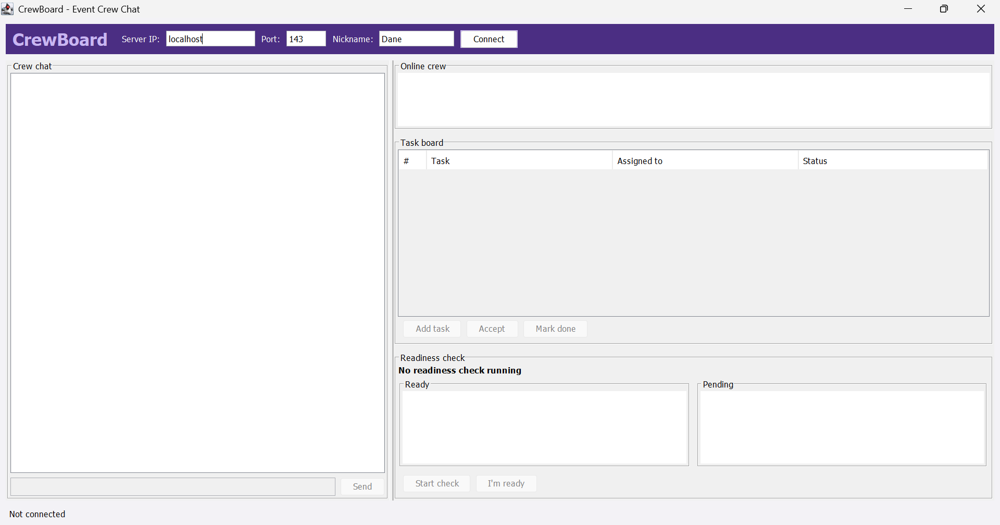
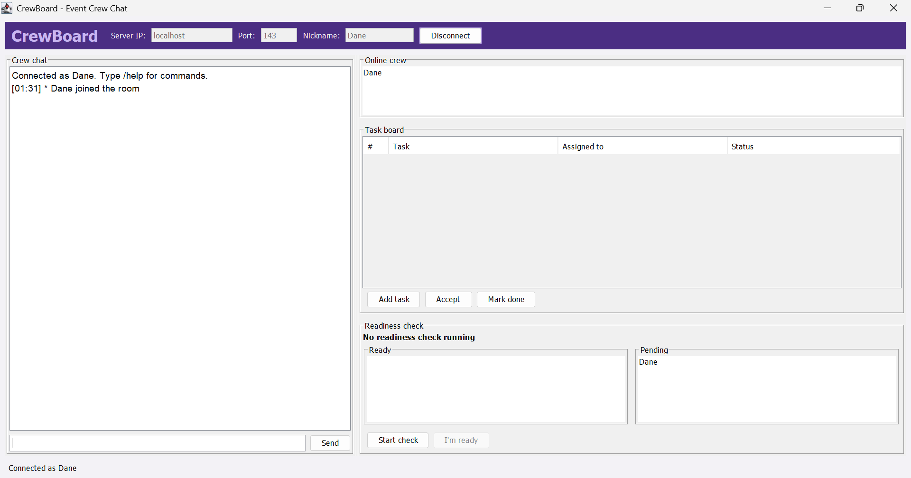

# EventCrew — Student Event Crew Chat

EventCrew is a Java desktop chat application for student event organizers. It helps an event crew communicate over a local network, assign responsibilities, track task progress, and confirm whether the team is ready before an event begins.

| Project information | Details |
|---|---|
| Course / Section | ITAS1 – BSIT 2B SD |
| Project | Network Programming — Java LAN Chat Application |
| Theme | Event Crew |
| Members | Danielle Grace B. Colacion · Crystal Ann P. Naol |
| GitHub usernames | DaneGrace · crystalannpaloga-cloud |
| Repository | 2d1a5ec748a2221bffad3fe57997f885c6bf4507 |


---

## Table of Contents

1. [Project Overview](#1-project-overview)
2. [Concept Proposal](#2-concept-proposal)
3. [User Problem and Theme](#3-user-problem-and-theme)
4. [Core Chat Features](#4-core-chat-features)
5. [Two Original Features](#5-two-original-features)
6. [Architecture](#6-architecture)
7. [Message Format](#7-message-format)
8. [Commands](#8-commands)
9. [Setup and LAN Instructions](#9-setup-and-lan-instructions)
10. [Screenshots](#10-screenshots)
11. [Testing Checklist](#11-testing-checklist)
12. [Division of Responsibilities](#12-division-of-responsibilities)
13. [Contribution Log](#13-contribution-log)
14. [Credits and AI Disclosure](#14-credits-and-ai-disclosure)
15. [Project Structure](#15-project-structure)

## 1. Project Overview

EventCrew is a Java Swing application designed for student event organizers, organization officers, and event volunteers. It combines a group chat with a shared task board and a team-readiness panel.

The application uses:

- **Java TCP sockets** (`ServerSocket` and `Socket`) for LAN communication.
- **Java Swing** for the desktop graphical user interface.
- **Concurrent server handlers** to serve multiple connected clients.
- **Shared in-memory server state** for online members, assigned tasks, and readiness status.
- **No database or external libraries**; project data is held in memory while the server is running.

One computer runs the server. Client computers connect using the server computer's IPv4 address and the same TCP port. The assignment requires testing with at least three client instances across two computers.

## 2. Concept Proposal

| Item | Description |
|---|---|
| Target users | Student event organizers, organization officers, and event volunteers |
| User problem | Event plans can get buried in ordinary group chats. Members may not know who is responsible for a task or whether the whole crew is ready. |
| Proposed solution | A LAN group chat with a shared task board and a readiness panel. |
| Original feature 1 | **Shared Task Board** — assign a task to an online member and track its status. |
| Original feature 2 | **Crew Readiness Check** — each connected member can confirm readiness; the panel shows the ready count and member states. |
| Approval | [Add instructor approval details and date] |

## 3. User Problem and Theme

Event preparation requires more than exchanging messages. Organizers need to know who is handling each responsibility and whether the crew is prepared to proceed.

EventCrew addresses these needs by keeping chat, tasks, and readiness information together in one application. The server distributes updates so connected clients can view the same current task and crew information.

## 4. Core Chat Features

- Configurable server IP address and TCP port.
- Nickname required when connecting; active nicknames must be unique.
- Group messages broadcast to connected clients with the sender and time.
- Online crew list updated when members join, leave, or change nicknames.
- Join, leave, and rename system notices.
- `/name`, `/ready`, `/exit`, and `/help` commands.
- Blank chat messages and invalid connection details are rejected.
- Network connection and message reading run outside the Swing Event Dispatch Thread; received interface updates are posted to the Swing thread.
- Sockets are closed when a client disconnects.

## 5. Two Original Features

### Feature 1 — Shared Task Board

The task board lets a member assign a task to an online crew member.

- Each task has an ID, title, assignee, and status.
- New tasks begin with the status `TODO`.
- The assigned member can update the task to `DOING` or `DONE`.
- The server checks that only the assigned member can change that task's status.
- Task updates are sent to all connected clients so their boards stay synchronized.

### Feature 2 — Crew Readiness Check

The readiness panel helps the team check whether members are prepared.

- Each connected member can switch their own readiness state.
- The online crew list marks members as ready or not ready.
- A live counter displays the number of ready members compared with the number connected.
- When at least two members are connected and everyone is marked ready, the server broadcasts: **“All crew members are ready. The event is GO!”**

Both features use shared server-side state rather than keeping separate independent copies on each client.

## 6. Architecture

```text
+----------------------+       TCP Socket       +---------------------------+
| EventCrewClient A    | <--------------------> | EventCrewServer           |
| Java Swing GUI       |                        | ServerSocket              |
| Chat / Tasks / Ready |                        |                           |
+----------------------+                        | Client Handler threads    |
                                                | Shared state:             |
+----------------------+       TCP Socket       | - connected users         |
| EventCrewClient B    | <--------------------> | - task list                |
| Java Swing GUI       |                        | - readiness states        |
+----------------------+                        |                           |
                                                | Broadcast updates         |
+----------------------+       TCP Socket       +---------------------------+
| EventCrewClient C    | <-------------------->              |
| Java Swing GUI       |
+----------------------+
```

**Message path:** A user action is sent from the client through a TCP socket. The server reads and validates the request, updates shared state when appropriate, and broadcasts the resulting update. The client reader receives server messages and schedules GUI changes on the Swing Event Dispatch Thread.

## 7. Message Format

The application uses line-based text messages. Fields are separated by `|`; user-provided text fields are URL-encoded before transmission.

| Direction | Message | Purpose |
|---|---|---|
| Client → Server | `NICK\|name` | Join with a nickname (first message) |
| Client → Server | `MSG\|text` | Send chat text or a supported command |
| Client → Server | `TASK_ADD\|title\|assignee` | Create and assign a task |
| Client → Server | `TASK_STATUS\|id\|status` | Change a task to `DOING` or `DONE` |
| Client → Server | `READY\|1` or `READY\|0` | Set the client's readiness state |
| Server → Client | `OK\|nick` | Confirm the nickname |
| Server → Client | `CHAT\|time\|sender\|text` | Deliver a chat message |
| Server → Client | `SYS\|time\|text` | Deliver a system notice |
| Server → Client | `USERS\|...` | Send online members and readiness states |
| Server → Client | `TASKS\|...` | Send the current task board |
| Server → Client | `ERR\|text` / `BYE` | Report an error or clean exit |

## 8. Commands

| Command | Description |
|---|---|
| `/name <newname>` | Change your nickname, subject to validation and uniqueness. |
| `/ready` | Toggle your readiness state. The GUI also provides a readiness control. |
| `/exit` | Leave the chat. |
| `/help` | Display the supported commands and usage information. |

Task assignment and task progress are controlled through the task board in the GUI.

## 9. Setup and LAN Instructions

### Requirements

| Requirement | Details |
|---|---|
| Java | JDK 17 or newer |
| IDE | Apache NetBeans or another Java IDE; command line is also supported |
| Dependencies | None — standard Java libraries only |
| Network | Same LAN or Wi-Fi for computers used in the demonstration |

### A. Compile the source code

Open a terminal in the project folder (the folder containing `src`) and run:

```bash
javac -d out src/*.java
```

### B. Start the server

On Computer A, run:

```bash
java -cp out EventCrewServer 5000
```

The server prints its IP address and listening port. Keep the server terminal open while clients are connected.

### C. Start the clients

On Computer A and Computer B, open another terminal in the project folder and run:

```bash
java -cp out EventCrewClient
```

In each client window, enter:

- **Server IP:** `localhost` for a client running on the same computer as the server; otherwise enter Computer A's LAN IPv4 address.
- **Port:** `5000` (must match the server port used above).
- **Nickname:** a unique name for that client.

Click **Connect**. Repeat until at least three client instances are connected across two computers.

### D. Find the server computer's IPv4 address on Windows

1. On the server computer, open Command Prompt.
2. Run `ipconfig`.
3. Find the active Wi-Fi or Ethernet adapter.
4. Use its **IPv4 Address** in the client running on the other computer.
5. If the connection is blocked, allow Java through Windows Defender Firewall on the server computer.

> **Port note:** The included `EventCrewServer` source defaults to port `1000` if no argument is supplied, while the client form initially displays `5000`. The run command above explicitly starts the server on `5000` so it matches the client's displayed value. Always use the same port on the server and every client.

### Troubleshooting

| Problem | What to check |
|---|---|
| Connection refused / server unavailable | Start the server first and verify the IP address and port. |
| Works on `localhost` but not on another computer | Use the server computer's LAN IPv4 address on the other computer. |
| Clients are on different networks | Connect both computers to the same LAN or Wi-Fi. |
| Windows blocks the connection | Allow Java through the server computer's firewall. |
| Nickname is rejected | Use a nonblank, unique nickname with letters, numbers, `_`, or `-` (1–16 characters). |
| Port is already in use | Choose another available port and enter that same port in every client. |

## 10. Screenshots

The images below are embedded with relative repository paths. Keep the `docs/screenshots/` folder in the GitHub repository so the images render directly on the README page.

### Connection screen



### Connected client screen



> **Screenshot/version note:** The supplied captures display the window title **CrewBoard** and port **143**, while the source files in this repository are titled **EventCrew** and the setup above uses port **5000**. These are the screenshots provided for this README; before final submission, replace them with fresh screenshots from the exact source version you are submitting if the interface or port has changed.

## 11. Testing Checklist

Record the actual result of each test after running it. Do not mark a test as passed until it has been demonstrated.

| # | Test | Steps | Expected result | Actual result | Status |
|---:|---|---|---|---|---|
| 1 | Three concurrent clients | Connect three clients across two computers. | All clients appear in the online list. | [Record result] | [Pass/Fail] |
| 2 | Message broadcast | Send a message from one client. | All connected clients receive it with sender and time. | [Record result] | [Pass/Fail] |
| 3 | Online list updates | Join and disconnect a client. | The list updates on all remaining clients. | [Record result] | [Pass/Fail] |
| 4 | Nickname change | Use `/name NewName`. | The new nickname appears for all clients. | [Record result] | [Pass/Fail] |
| 5 | Duplicate nickname | Attempt to use a nickname already online. | The server rejects the duplicate. | [Record result] | [Pass/Fail] |
| 6 | Blank message | Attempt to send an empty message. | The blank message is rejected. | [Record result] | [Pass/Fail] |
| 7 | Invalid IP or port | Enter an invalid address or port. | A clear connection error is shown. | [Record result] | [Pass/Fail] |
| 8 | Unavailable server | Try connecting while the server is stopped. | The client reports the connection problem without freezing. | [Record result] | [Pass/Fail] |
| 9 | Clean exit | Use `/exit` on one client. | That client disconnects and others receive a leave notice. | [Record result] | [Pass/Fail] |
| 10 | Abrupt disconnect | Close one client unexpectedly. | The server remains available to other clients. | [Record result] | [Pass/Fail] |
| 11 | Task board synchronization | Assign a task and update its status as the assignee. | All clients show the same task, assignee, and status. | [Record result] | [Pass/Fail] |
| 12 | Assignee validation | Try updating a task from a non-assignee client. | The server rejects the unauthorized status change. | [Record result] | [Pass/Fail] |
| 13 | Readiness synchronization | Toggle readiness on multiple clients. | The ready counter and member states update on all clients. | [Record result] | [Pass/Fail] |
| 14 | All-ready announcement | Connect at least two clients and mark everyone ready. | The server announces that the event is GO. | [Record result] | [Pass/Fail] |

## 12. Division of Responsibilities

Update this table to reflect the work each partner actually completed.

| Member | Assigned responsibility | Actual contribution |
|---|---|---|
| Danielle Grace B. Colacion | Creating the system | The completed work is the system |
| Crystal Ann P. Naol | Testing the system if it's working | Running the system correctly |

Both partners should be able to explain the code, demonstrate the application, and answer questions about their own contributions.

## 13. Contribution Log

Add dated tasks and links to the relevant GitHub commits for both members.

| Member | Date | Task completed | Commit link |
|---|---|---|---|
| Danielle Grace B. Colacion | 2026-12-15 | Readme | [2d1a5ec748a2221bffad3fe57997f885c6bf4507] |
| Crystal Ann P. Naol | 2026-12-15 | Readme Changes | 54d2e15795ddf100a720dabb07c4694091f05666 |

## 14. Credits and AI Disclosure

- **Language and interface:** Java and Java Swing.
- **Networking:** Java `java.net` socket classes.
- **External libraries/assets:** None identified in the supplied source archive. Update this section if any are added.
- **AI assistance:** Disclose any AI tools actually used to help plan, write, debug, or document the project. Review and edit this statement so it accurately reflects the team's work.

## 15. Project Structure

```text
EventCrew/
├── README.md
├── build.xml
├── manifest.mf
├── nbproject/
├── src/
│   ├── EventCrewClient.java
│   └── EventCrewServer.java
└── docs/
    └── screenshots/
        ├── 01-connection-screen.png
        └── 02-connected-client.png
```

---
